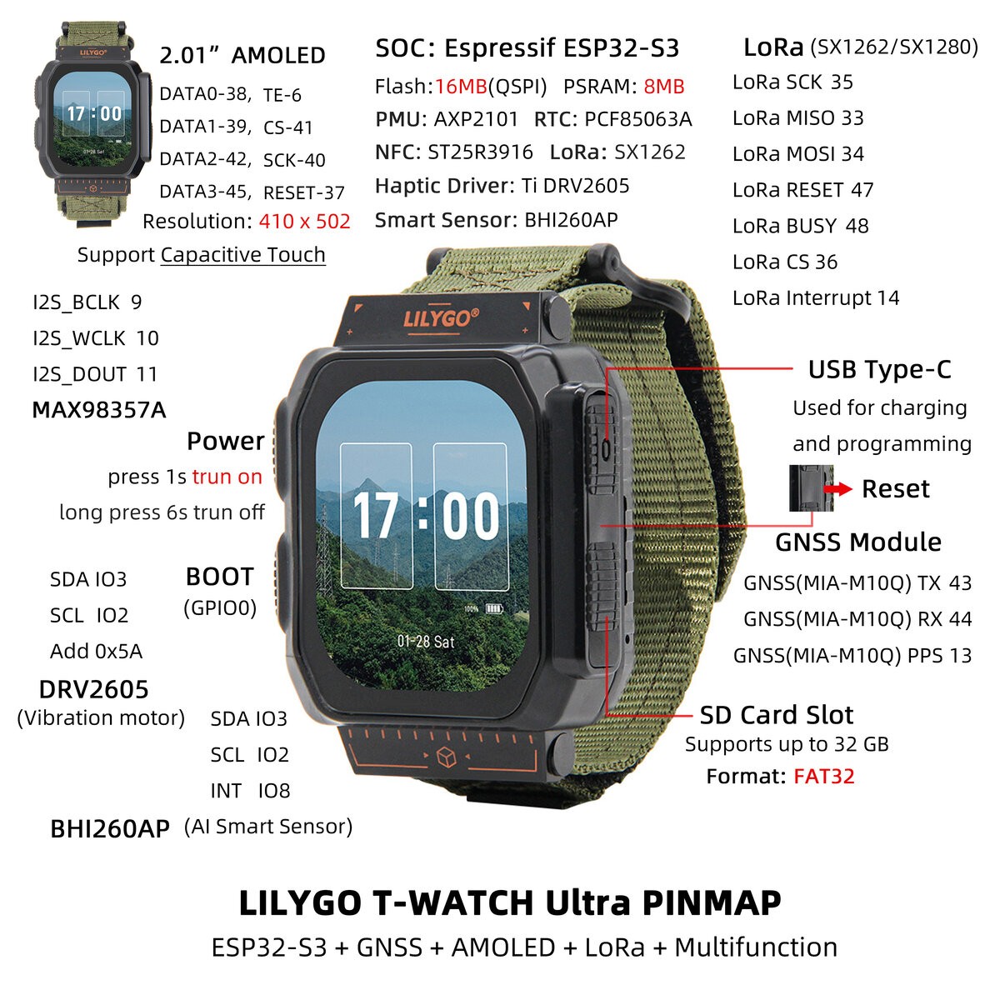

# WatchApp

Arduino sketch for the LilyGo T-Watch Ultra, built with `arduino-cli`, ESP32 core 3.3.10,
`../LilyGoLib`, and `../LilyGoLib-ThirdParty`.

```sh
make build              # compile into ./build
make upload             # flash (auto-detects /dev/ttyACM*, or pass PORT=...)
make monitor            # serial console at 115200
make flash              # build + upload + monitor
make settime            # set the watch's RTC from this computer's clock (sketch must be running;
                        # not needed once the watch has Wi-Fi or a GPS fix, which set it)
make RADIO=Radio_LR1121 build   # if your watch has a different radio than SX1262
```

## Using the watch

- The screen turns off after 10 s without input (change it in Settings); tap it or press PWR or BOOT to wake it. A tap or
  PWR wakes it on the screen you left (the waking tap doesn't press anything). A quick press of
  PWR while the screen is on turns it off right away (a ringing alarm keeps it on).
- **BOOT** goes straight back to the watch face from any app or the Apps page, waking the screen
  if needed. It does nothing while an alarm is ringing, so Snooze/Stop stay on screen.
- Swipe up on the watch face for Apps. **Alarms** lists your alarms (up to 8): tap one to edit
  or delete it, use its switch to turn it on/off, and tap **+** to add one. In the editor, pick
  repeat days (or tap Weekdays / Weekends / Daily); with no days selected the alarm rings once and
  then switches itself off. Alarms wake the screen, vibrate and beep, and stop after 1 minute;
  **Snooze** waits 5 minutes.
- Alarms are saved in flash (NVS) and survive reboots and reflashing.
- **Messages** talks to MeshCore nodes over LoRa (USA/Canada preset, 910.525 MHz). It lists the
  Public channel and a chat for each MeshCore companion that has advertised nearby, with unread
  counts. New messages buzz (unless turned off in Settings) and wake the screen. Tap a chat to read it and the pencil button to
  reply: pick a quick reply, or **Type a message** for a slide-up keyboard (one-shot shift,
  **1#** for numbers and punctuation, then **#+=** for the rest of the symbols, ✓ to send). Direct
  messages show Sending / Sent / Delivered / Failed. Tap the signal icon in the list to advertise
  this watch so others can add it. The **This watch** card at the bottom of the list shows the
  name others see (TWatch-XXXX by default); tap it to rename the watch, which also re-advertises
  it. Chats are saved on the FFat partition. The watch runs MeshCore's companion radio firmware, so
  its contacts, channels and radio settings are the ones the MeshCore phone app shows.
- **GPS** has an on/off switch (saved across reboots; off puts the receiver in its low-power
  backup mode, where it keeps its satellite data, so turning it back on gets a fix in about 10 s),
  the current position, altitude, speed and HDOP, and a bar per satellite showing signal
  strength (green = used in the fix). While GPS is on, the watch face shows a satellite icon at the top
  right: gray with the satellites in view while searching, green with the satellites used once it
  has a fix. A fix also sets the clock from GPS time (then hourly while it lasts), so the time is
  right away from Wi-Fi. **Record track** (on by default) shows the activity the motion sensor
  detects (still, walking, running, cycling or driving) and, while GPS has a fix and you're moving,
  saves a point every 10 m (at most every 3 s) labeled with that activity to
  `/tracks/YYYY-MM-DD.csv` on the SD card (`time,lat,lon,activity`, with W/R/B/D for the
  activity), one file per day. Without a card the day's track is kept until the watch restarts.
- **Steps** counts steps with the motion sensor's built-in step counter, all the time and without
  GPS. A ring fills toward the daily goal (orange, green once it's reached) around today's count,
  with the estimated distance (2.5 ft per step) and percent of goal below it, a bar chart of the last
  seven days, and **Daily goal** buttons (5k-15k, default 10k). The count restarts at local
  midnight and is saved at most once a minute, so a restart loses at most a minute of steps.
- **SD Card** shows the card's size and free space, a **Test read & write** button (writes 256 KB,
  reads it back, checks it, deletes it, and reports speeds), and a file browser: tap folders to
  open them and text files to view their first 2 KB. Cards must be FAT32; if the card can't be read,
  **Format card** erases it and formats it FAT32. Inserting or removing the card while the app is
  open remounts it.
- **Map** shows offline map tiles from the SD card with your GPS position as a blue dot. Drag to
  pan, **+**/**−** step through the zoom levels on the card, and the arrow button re-centers on
  you and follows (orange while following). Tiles are standard 256 px web map tiles at
  `/maps/<zoom>/<x>/<y>.png` (or baseline `.jpg`). `tools/download_map_tiles.py` downloads an area
  into that layout from a source whose terms allow offline use, such as the public-domain USGS Topo
  map (US only, no key): `python3 tools/download_map_tiles.py --center LAT,LON --radius-km 10
  --zoom 10-16 --url
  'https://basemap.nationalmap.gov/arcgis/rest/services/USGSTopo/MapServer/tile/{z}/{y}/{x}'`
  (about 2,800 tiles, 31 MB). Free plans of MapTiler and Thunderforest forbid bulk downloads, and
  the tool refuses tile.openstreetmap.org, which forbids them too. Copy the `maps` folder to the
  root of the card from a computer. Tiles fill in one at a time (about 0.1 s each) the first time
  they're shown, and the next zoom level in and out is prepared in the background, so zooming is
  usually immediate. Today's activity track is drawn over the map as a breadcrumb trail colored by
  activity (green walking, orange running, purple cycling, red driving), with a legend at the
  bottom.
- **Wi-Fi** has an on/off switch (off by default, saved across reboots), the connection status
  with IP address and signal, and the nearby networks strongest first (tap ⟳ to scan again). Tap a
  network to join it; secured ones ask for the password on the slide-up keyboard (the eye button
  shows it). A network that joins becomes the saved network, which the watch reconnects to at
  boot and whenever it's back in range; **Forget** removes it. A failed join says why (wrong
  password, network not found, or timed out) and goes back to the saved network. While connected,
  the watch face shows a green Wi-Fi icon at the top left whose lit arcs show the signal strength.
  Connecting also sets the clock from internet time (NTP), and it re-syncs every hour while
  connected; the **Time synced** row shows when that last happened.

- **Bluetooth** lets the MeshCore phone app use the watch as its radio, like any MeshCore
  companion node. It has an on/off switch (on by default, saved across reboots) and shows the
  status, the name the app lists (**MeshCore-** plus the watch name) and the six-digit PIN to
  enter when pairing. In the app, tap Connect, choose the watch, and enter the PIN. Messages sent
  from the phone to the Public channel or to a companion also appear in the watch's chats, and
  messages received while the phone is away are queued for it (up to 16). Bluetooth uses about
  75 KB of the internal RAM, so turn it off if you don't use the phone app. A rename on the watch
  updates the Bluetooth name right away; a rename or PIN change from the app takes effect after a
  reboot.
- **Settings** has a **Brightness** slider (10-100%) for the screen, which changes as you drag,
  and **Screen timeout**: how long the screen stays on without input (5 s to 2 min, 10 s by
  default), and **Notifications**: turn off **Vibrate for messages** to stop the buzz for new
  messages (they still wake the screen; alarms always vibrate). All are saved across reboots.

If uploading fails or the USB port keeps reconnecting, enter download mode: hold **BOOT**,
press **RST**, release **BOOT**, upload, then press **RST** to run.

`build/compile_commands.json` can be used by clangd for editor completion.

## Hardware

Buttons, ports and pin assignments of the T-Watch Ultra (LilyGo's pin map):


