# WatchApp

Firmware for the LilyGo T-Watch Ultra: a watch face with app launcher, MeshCore LoRa messaging that
also works as a companion radio for the MeshCore phone app, offline topo maps, GPS with activity
tracks, a step counter, weather, alarms, Wi-Fi, SD card and settings.

## Screenshots

| | | | |
|:-:|:-:|:-:|:-:|
| 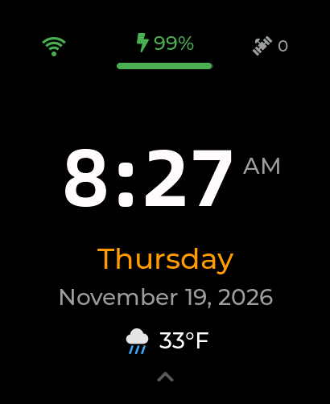 | 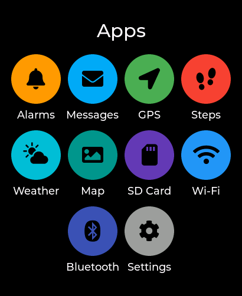 | 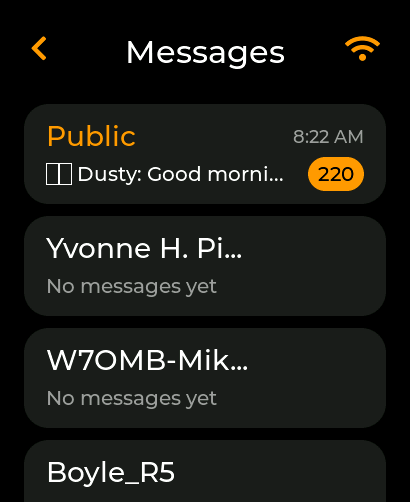 | 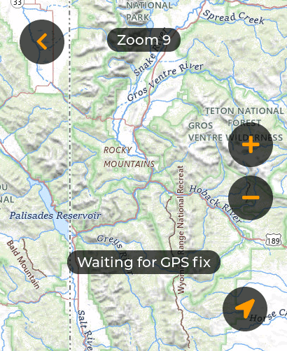 |
| Watch face | Apps | Messages | Map |
| 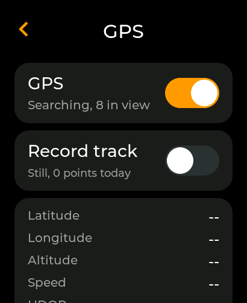 | 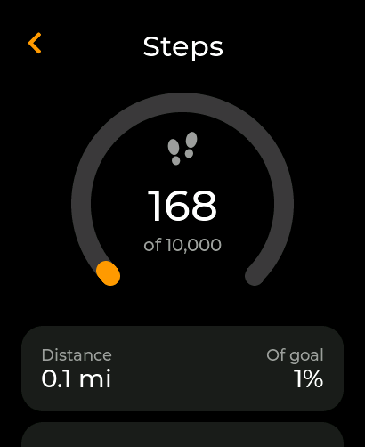 | 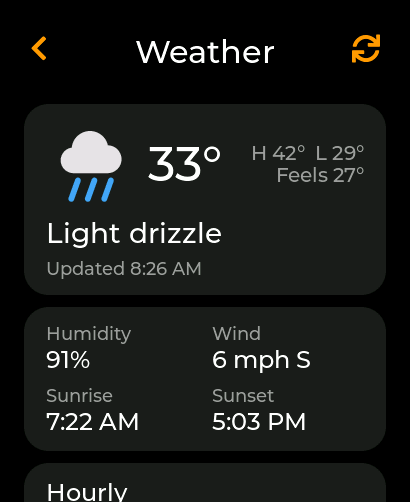 | 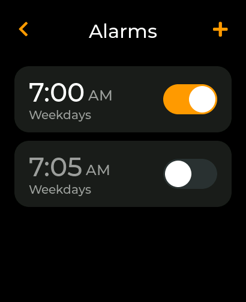 |
| GPS | Steps | Weather | Alarms |
| 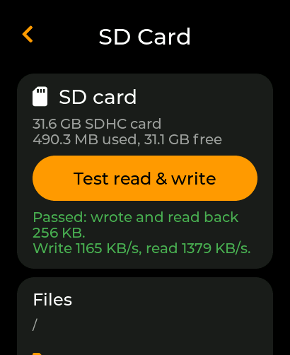 | 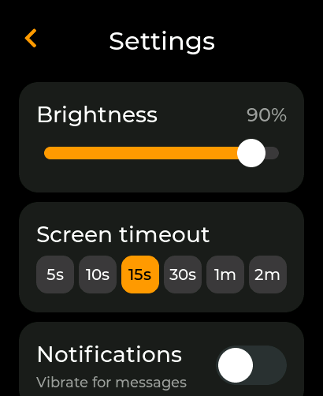 | | |
| SD Card | Settings | | |

Captured from a T-Watch Ultra with `make screenshot`.

## Building from source

Built with `arduino-cli`, ESP32 core 3.3.10, `../LilyGoLib` and `../LilyGoLib-ThirdParty`. The code
is in `src/` (`setup()` and `loop()` are in `src/main.cpp`); `WatchApp.ino` is only the stub file
Arduino requires, `lib/MeshCore` is the copy of MeshCore it builds with, and `tools/` has the scripts
that generate the images in `src/`. Arduino needs the project's folder to be named `WatchApp`, like
the `.ino`, so clone it next to LilyGoLib with `git clone git@github.com:digicyc/twatch.git WatchApp`.

```sh
make deps               # once: Arduino libraries MeshCore and the Weather app need
make build              # compile into ./build
make upload             # flash (finds the watch's USB port, or pass PORT=/dev/ttyACMx)
make monitor            # serial console at 115200
make flash              # build + upload + monitor
make settime            # set the clock from this computer (GPS, Wi-Fi and the phone app also set it)
make screenshot         # save the screen to screenshot.png (OUT=file.png); needs uv
make RADIO=Radio_LR1121 build   # if your watch has a different radio than SX1262
```

If uploading fails or the USB port keeps reconnecting, enter download mode: hold **BOOT**, press
**RST**, release **BOOT**, upload, then press **RST** to run. `build/compile_commands.json` works
with clangd for editor completion.

## Using it

- **Screen and buttons.** The screen turns off after the Settings timeout (10 s by default); a tap,
  PWR or BOOT wakes it where you left it, and the waking tap doesn't press anything. A quick press
  of PWR turns the screen off right away. **BOOT** goes back to the watch face from anywhere,
  except while an alarm rings. Swipe up on the face for the apps.
- **Watch face**: time, date, battery, a Wi-Fi icon while connected, GPS satellites (gray while
  searching, green with a fix), and the current weather.
- **Messages** (MeshCore over LoRa, USA/Canada preset, 910.525 MHz): a chat for each channel (Public
  and any added here or in the phone app) and for each companion that has advertised nearby, with
  unread counts. **Join a channel** adds a hashtag channel such as `#hiking`, which everyone who
  joins the same name shares; the trash icon in a channel leaves it (up to 8 channels). Names show
  emoji, in the text color. New messages buzz (Settings can turn that off) and wake the screen.
  Reply with a quick reply or the slide-up keyboard; direct messages show Sending / Sent / Delivered
  / Failed. The signal icon advertises this watch, and the **This watch** card sets the name others
  see (TWatch-XXXX by default). Chats are kept on the FFat partition.
- **Bluetooth** lets the MeshCore phone app use the watch as its radio. It shows the name the app
  lists (**MeshCore-** plus the watch name) and the six-digit PIN to enter when pairing. Messages
  sent from the phone also appear in the watch's chats, and up to 16 received while the phone is
  away are queued for it. Bluetooth uses about 75 KB of internal RAM; turn it off if you don't use
  the phone app.
- **Map** shows offline tiles from the SD card with your position as a blue dot and today's
  activity track as a trail colored by activity. Drag to pan, **+**/**−** step through the zoom
  levels on the card, and the arrow re-centers on you and follows. Tiles are standard 256 px web
  map tiles at `/maps/<zoom>/<x>/<y>.png` (or baseline `.jpg`); `tools/download_map_tiles.py`
  downloads an area from a source that allows offline use, such as the public-domain USGS Topo map
  (US only, no key), and you copy its `maps` folder to the card:

  ```sh
  python3 tools/download_map_tiles.py --center LAT,LON --radius-km 10 --zoom 10-16 \
      --url 'https://basemap.nationalmap.gov/arcgis/rest/services/USGSTopo/MapServer/tile/{z}/{y}/{x}'
  ```

  `--bbox west,south,east,north` takes an area instead, for example a low-detail overview of a
  state or the whole country. The tool refuses tile.openstreetmap.org, whose terms forbid bulk
  downloads (as do the free plans of MapTiler and Thunderforest).
- **GPS**: on/off switch, position, altitude, speed, HDOP, and signal bars per satellite. A fix sets
  the clock (then hourly). To save battery the receiver only runs while the screen is on or a track
  is recording; otherwise it sleeps in u-blox backup mode, waking for a minute every half hour to
  keep its satellite data fresh, so a fix comes back in about 10 s. **Record track** (on by
  default) saves a point every 10 m while you move, labeled with the activity the motion sensor
  detects (walking, running, cycling, driving), to `/tracks/YYYY-MM-DD.csv` on the SD card.
- **Steps** uses the motion sensor's step counter, all day and without GPS: a ring toward the daily
  goal (5k-15k, 10k by default), distance, and the last seven days. It restarts at local midnight.
- **Weather** gets an [Open-Meteo](https://open-meteo.com) forecast (free, no key) over Wi-Fi for
  your GPS position, rounded to about 1 km: current conditions, the next 12 hours and 5 days, in °F
  and mph. It updates every 30 minutes, after moving 10 km, or when you tap ⟳, and the last forecast
  is kept across reboots.
- **Alarms**: up to 8, with repeat days (none rings once). They wake the screen, vibrate and beep
  for a minute; **Snooze** waits 5 minutes. Saved in flash, so they survive reflashing.
- **Wi-Fi** (off by default): join a network with the slide-up keyboard; the watch reconnects to it
  at boot and when it's back in range, and **Forget** removes it. Connecting sets the clock from
  internet time, re-synced hourly.
- **SD Card**: size and free space, a read/write speed test, a file browser and text viewer, and
  **Format card** (FAT32) for a card that can't be read. Inserting or removing the card remounts it.
- **Settings**: brightness (50% by default), screen timeout (5 s to 2 min) and vibrate for messages.

The watch's RTC keeps UTC. Wi-Fi, a GPS fix, the phone app or `make settime` set it.

## Testing over USB serial

The firmware takes one-line commands on the USB serial port (115200): `T<unix time>` sets the clock,
`S` sends a screenshot (what `tools/screenshot.py` reads), `P<x>,<y>` taps the screen, and
`D<x1>,<y1>,<x2>,<y2>` drags across it (`D205,420,205,80` swipes up to the apps). Don't change DTR
or RTS on the port: that resets the ESP32-S3.

## MeshCore

`lib/MeshCore` is a pinned copy of the parts of [MeshCore](https://github.com/meshcore-dev/MeshCore)
this uses, including the companion radio node the phone app talks to; `tools/sync-meshcore.sh`
updates it (see its header). The Makefile's `MESH_FLAGS` set the radio defaults for a new node;
after that, the phone app changes them.

## Hardware

Buttons, ports and pin assignments of the T-Watch Ultra (LilyGo's pin map):

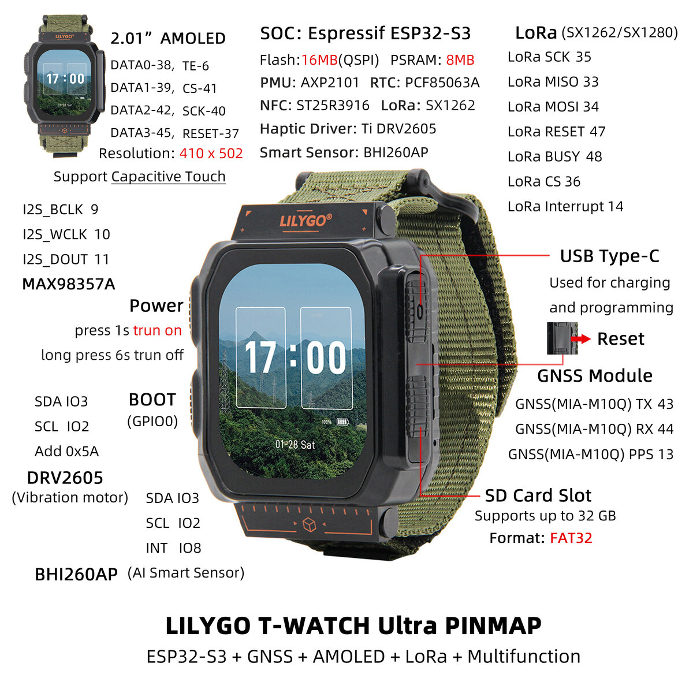
