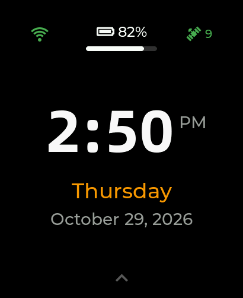
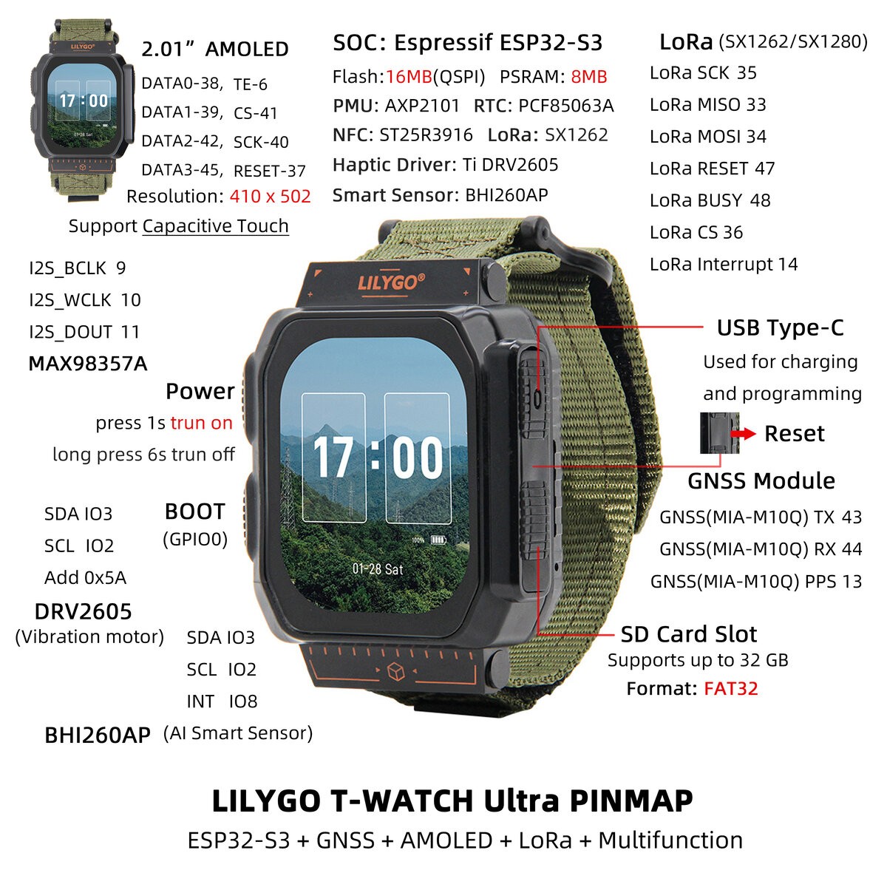
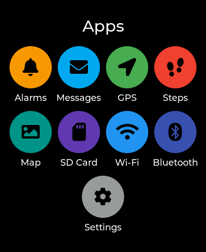
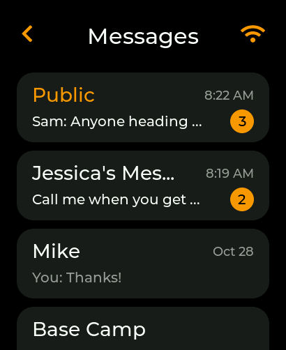
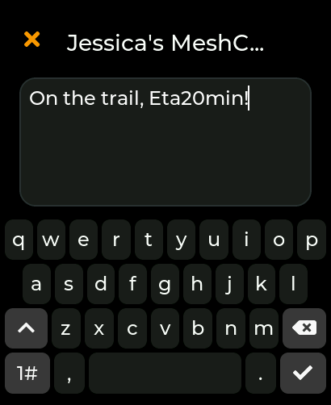
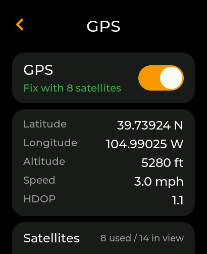
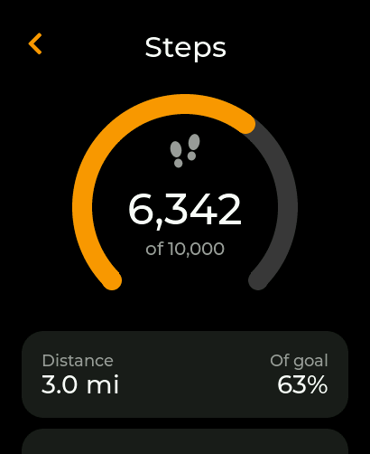
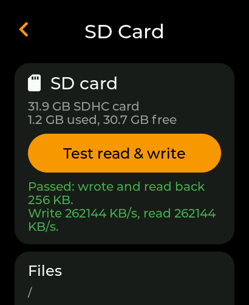
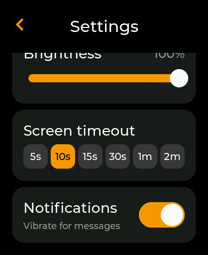

# LilyGo T-Watch Ultra Review: A LoRa Mesh Messenger, GPS Map and Step Tracker on Your Wrist

The LilyGo T-Watch Ultra looks like a chunky smartwatch, but it's really an ESP32-S3 development
board with a strap. It packs LoRa, GPS, Wi-Fi, Bluetooth, NFC, a microSD slot and a Bosch "AI"
motion sensor behind a 2.06-inch AMOLED screen. It ships with no real firmware of its own. It runs
whatever you write for it.

I spent about a week writing that firmware: a watch face, alarms, a LoRa messenger compatible with
MeshCore, GPS with offline topo maps and activity tracks, Wi-Fi with internet time, a Bluetooth
link to the MeshCore phone app, and a step counter. This post reviews the hardware and walks
through what building on it was like.

**Source code:** [github.com/digicyc/twatch](https://github.com/digicyc/twatch)

## The hardware

| Part | Details |
| --- | --- |
| MCU | ESP32-S3, dual-core Xtensa LX7 at 240 MHz |
| Memory | 16 MB flash, 8 MB PSRAM |
| Display | 2.06" CO5300 AMOLED, 410 × 502, 600 nits, QSPI |
| Touch | CST9217 capacitive |
| LoRa | Semtech SX1262 (868, 915 or 920 MHz versions) |
| GNSS | u-blox MIA-M10Q |
| Wireless | Wi-Fi 802.11 b/g/n, Bluetooth 5.0 LE |
| Motion | Bosch BHI260AP smart sensor (IMU with an onboard processor) |
| Other | ST25R3916 NFC, DRV2605 haptic driver, MAX98357A amplifier, PDM mic, PCF85063A RTC |
| Power | AXP2101 PMU, 1100 mAh (4.07 Wh) battery, USB-C |
| Storage | microSD, up to 32 GB FAT32 |
| Size | 63.5 × 49 × 22 mm, IP65 |
| Price | about $79 from LilyGo |

That's a lot of radio for a wrist. The SX1262 and the u-blox M10 are the parts that make it
different from a typical ESP32 watch: together they make an off-grid messenger and navigator
possible without a phone.

### First impressions

- **The screen is the star.** The AMOLED is sharp, bright and truly black. At 410 × 502 there's
  room for real UI: a full QWERTY keyboard fits, and map tiles look like maps.
- **It's thick.** At 22 mm deep it wears like an outdoor GPS watch, not a smartwatch.
- **Two buttons.** PWR goes through the power chip and BOOT is a plain GPIO, so both can be
  used in your own firmware. I made a quick PWR press toggle the screen and BOOT jump back to the
  watch face.
- **The sensor does the heavy lifting.** The BHI260AP runs its own firmware, so step counting and
  activity recognition (still, walking, running, cycling, driving) cost the ESP32 almost nothing.

## The software stack

- **Arduino on ESP32 core 3.3.10**, built and flashed from the command line with `arduino-cli`
  and a small Makefile (`make build`, `make upload`, `make monitor`).
- **[LilyGoLib](https://github.com/Xinyuan-LilyGO/LilyGoLib)** for the board drivers: display,
  touch, power, the sensor, GPS, the SD card and the radio all hang off one `instance` object.
- **LVGL 9** for the UI.
- **[MeshCore](https://github.com/meshcore-dev/MeshCore)** for the LoRa mesh protocol, vendored
  at a pinned commit.

The firmware is about 5,900 lines of C++ across 31 commits. It uses 2.59 MB of the 3 MB app
partition (82%), leaving the rest of the 16 MB flash as a FAT partition for saved chats.

## What I built

Swipe up from the watch face for the Apps page. Each app is its own LVGL screen with the same dark
cards and orange accents.

### Alarms

Up to eight alarms with repeat days (or Weekdays, Weekends, Daily presets). They wake the screen,
vibrate through the DRV2605, beep and snooze. Alarms are stored in NVS, so they survive reboots and
reflashing.

### Messages: a MeshCore messenger on the wrist

  
  

This was the headline feature. The watch joins a [MeshCore](https://github.com/meshcore-dev/MeshCore) LoRa mesh
on the USA/Canada preset (910.525 MHz, SF7, 62.5 kHz) and shows the Public channel plus a chat for
each companion node it hears. New messages buzz and wake the screen. Replies are either canned
quick replies or typed on a compact slide-up keyboard I wrote for the small screen (one-shot
shift, a numbers layer and a symbols layer). Direct messages show Sending, Sent, Delivered or
Failed.

I started with my own subset of the protocol, then switched to running MeshCore's actual
**companion radio firmware** on the watch. That gave full compatibility with real MeshCore nodes
and with the phone app for free. A script (`tools/sync-meshcore.sh`) copies the needed parts of
MeshCore at a pinned commit and applies a small patch, so updating MeshCore stays repeatable.

### Bluetooth: the watch as a MeshCore node for your phone

The MeshCore phone app can connect to the watch over Bluetooth and use it as its radio, the same
as any MeshCore companion device. Messages sent from the phone also show up in the watch's chats,
and messages received while the phone is away are queued for it.

The catch was the Bluetooth stack. MeshCore's ESP32 Bluetooth code targets Bluedroid, but this
Arduino core is built with **NimBLE**. I ported MeshCore's Nordic UART service, with its static
pairing PIN, to NimBLE. Bluetooth takes about 75 KB of the ESP32's internal RAM, so it has its own
on/off switch.

### GPS

The GPS app shows position, altitude, speed, HDOP and a signal bar for each satellite, and adds a
small satellite icon with a count to the watch face. A fix also sets the clock.

The interesting work was start-up time. Cutting power to the receiver meant a cold start every
time: about 30 seconds to a fix indoors. Now "off" sends the u-blox a **UBX-RXM-PMREQ** backup
command so it keeps its satellite data. On wake, the watch sends **UBX-MGA-INI-TIME_UTC** with its
own clock, because in backup mode the receiver has no clock of its own and the time aid is what
makes the restart fast. Measured indoors, the receiver has the time in about 2 seconds and a fix in
8 to 10 seconds.

Along the way I found a small bug in LilyGoLib: its GPS power-off path sets the RX pin twice
instead of RX and TX. The backup-mode approach avoids that code entirely.

### Offline maps on the SD card

The Map app shows standard 256 px web map tiles from `/maps/<z>/<x>/<y>` on the microSD card,
with a blue dot for your position and a follow mode. A Python tool downloads an area from a source
whose terms allow offline use. The public-domain **USGS Topo** map works well in the US: 10 km
around a point at zoom 10 to 16 is about 2,800 tiles and 31 MB.

The first version was slow: zooming felt broken because every tile was read and decoded on the UI
thread. The fixes:

- Decoded tiles are cached in PSRAM (32 tiles of 128 KB each).
- JPEG decoding runs on the ESP32's second core, so the UI and radio keep running.
- Tiles closest to the middle of the screen load first. While the map is still, the next zoom
  level in and out is decoded in the background, so the zoom buttons usually find tiles ready.
- Zoom acts on touch-down instead of release, which hides the ~130 ms redraw.

### Activity tracks: breadcrumbs labeled by the motion sensor

The BHI260AP's activity recognition labels a GPS track. While you're moving with a good fix, the
watch saves a point every 10 m to `/tracks/YYYY-MM-DD.csv` on the SD card, tagged walking,
running, cycling or driving. The Map app draws the day's track as a breadcrumb trail colored by
activity: green for walking, orange for running, purple for cycling and red for driving.

### Steps

  
  

The sensor's hardware step counter runs all the time, with or without GPS. The Steps app shows
today's count in a ring that fills toward a daily goal and turns green when you hit it. It also
shows an estimated distance, a seven-day bar chart and goal presets from 5k to 15k. The count
resets at midnight and is saved to flash once a minute.

### Wi-Fi and internet time

A Wi-Fi app scans for networks, joins them with the on-screen keyboard and remembers one saved
network. While connected, the watch face shows a Wi-Fi icon whose arcs light up with signal
strength. Connecting sets the clock over NTP and re-syncs hourly, and the app shows when the last
sync happened.

### SD card and Settings

  
  

The SD Card app shows capacity and free space, runs a read/write self-test, browses files and can
format the card as FAT32. Settings has brightness, screen timeout (5 seconds to 2 minutes), and a
switch to stop new messages from vibrating.

## Bugs worth sharing

- **"The watch doesn't charge."** It was a USB hub that passed data but no power (VBUS). Plugged
  straight into the laptop, it charged fine. If your T-Watch won't charge, check the cable and hub
  before the firmware.
- **The clock was way off after the battery died.** MeshCore restores the clock from the newest
  contact timestamp at boot, which is meant for boards without a real-time clock. On this watch it
  rolled a correct clock *backwards* on every boot. I patched it to only ever move the clock
  forward, and added clock sync from GPS and NTP.
- **Waking the screen shouldn't lose your place.** A tap after the screen times out now wakes it
  on exactly the screen you left, and the waking tap doesn't press whatever is under your finger.

## How I worked

- **A desktop LVGL simulator.** The real `.cpp` screens compile on the PC against stub headers and
  render to image files. Every screenshot in this post came from it, with sample data. Iterating
  on layout this way is much faster than flashing.
- **Serial commands for testing.** `make settime` sets the watch clock from the laptop, and
  temporary serial commands let me trigger and inspect features on the real hardware.
- **Generated icons.** The satellite, Wi-Fi and footprint icons are small Python scripts that
  draw antialiased alpha-only images for LVGL, so the watch can tint them any color.
- **An AI coding agent.** Most of the code was written with [Amp](https://ampcode.com), working
  in the repo with me: reading LilyGoLib and MeshCore source, building, flashing and checking
  serial logs on the real watch. I tested each feature on the watch myself.

## Verdict

**Pros**

- Phenomenal hardware for the price: LoRa, a modern u-blox GNSS, Wi-Fi, BLE, NFC and microSD in
  an IP65 wearable.
- A beautiful 410 × 502 AMOLED with enough room for a real UI.
- 8 MB of PSRAM makes things like a map tile cache practical.
- The BHI260AP handles steps and activity recognition on its own.
- LilyGoLib gets you from nothing to a working display, touch and radio quickly.

**Cons**

- No useful stock firmware. Out of the box it's a dev kit, so plan to write code.
- Thick on the wrist.
- Internal RAM gets tight once Bluetooth, Wi-Fi and LoRa all run at once.
- The SD slot is limited to 32 GB FAT32, and the 3 MB app partition fills up quickly.
- Documentation is spread across LilyGo's wiki, LilyGoLib and example code.

If you want a finished smartwatch, this isn't it. If you want a wrist-sized platform for off-grid
messaging, navigation and sensor experiments, the T-Watch Ultra is one of the most capable boards
you can buy, and it was a lot of fun to build on.

## Links

- Project source: [github.com/digicyc/twatch](https://github.com/digicyc/twatch)
- LilyGo T-Watch Ultra: [product page](https://lilygo.cc/products/t-watch-ultra) and
  [wiki](https://wiki.lilygo.cc/products/t-watch-series/t-watch-ultra)
- [LilyGoLib](https://github.com/Xinyuan-LilyGO/LilyGoLib)
- [MeshCore](https://github.com/meshcore-dev/MeshCore)
- [LVGL](https://lvgl.io)
- [USGS National Map basemaps](https://basemap.nationalmap.gov/)
